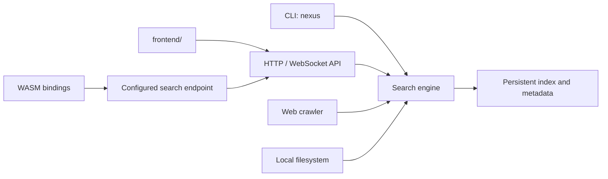

# NEXUS-ENGINE

> A privacy-first Rust search engine for local files and crawled web content, with a command-line interface, HTTP and WebSocket APIs, a browser-facing frontend, and a `wasm32-unknown-unknown` library build. [1] [2]

[](https://www.rust-lang.org/)
[](https://webassembly.org/)
[](./Cargo.toml)

[Documentation](#getting-started) · [HTTP API](#http-api) · [Report a bug](https://github.com/vincenzo-afk/NEXUS-ENGINE/issues/new?template=bug_report.md) · [Request a feature](https://github.com/vincenzo-afk/NEXUS-ENGINE/issues/new?template=feature_request.md)

## Table of contents

- [About](#about)
- [Architecture](#architecture)
- [Technology](#technology)
- [Getting started](#getting-started)
- [Usage](#usage)
- [HTTP API](#http-api)
- [Project structure](#project-structure)
- [Features and limitations](#features-and-limitations)
- [Testing](#testing)
- [Deployment](#deployment)
- [Contributing](#contributing)
- [Security](#security)
- [License](#license)
- [Acknowledgments](#acknowledgments)

---

## About

NEXUS indexes local files and web pages into one searchable corpus. Its retrieval path combines a BM25-style lexical index with signals such as document title or filename matches, recency, PageRank for crawled pages, click history, and an optional lexical-vector reranking signal. The crawler is designed to respect `robots.txt`, use crawl budgets, constrain request sizes, and persist crawl state for later resumption. [1] [4]

The project supports four result scopes: `local` for filesystem documents, `web` for crawled non-onion pages, `both` for a merged hybrid view, and `tor` for indexed `.onion` pages only. It also exposes type-ahead suggestions, query filters, bang redirects, optional AI-assisted reranking and cited summaries, and browser bindings that can fetch a configured search endpoint. [2] [3]

| Capability | Implementation |
| --- | --- |
| Local search | Recursive filesystem indexing, text extraction, incremental watching, and BM25-oriented ranking. |
| Web search | HTTP/HTTPS crawling with robots handling, sitemaps, link discovery, deduplication, PageRank, and crawl budgets. |
| Search interfaces | CLI, JSON HTTP API, WebSocket service, static frontend, and an optional WASM library build. |
| Privacy and safety | Conservative privacy defaults, optional API authentication, configured CORS, query bounds, rate limiting, and source-mode separation. |

## Architecture



The executable parses CLI input and dispatches to the library modules. The HTTP server loads the configured index and serves requests, while the frontend consumes the HTTP API. The WASM library is feature-gated and produces a `cdylib` artifact for browser integration. [1] [2] [3]

## Technology

| Area | Verified technology |
| --- | --- |
| Language and edition | Rust 2021; package version `0.3.0`. [1] |
| CLI | `clap` 4.4.18 with derived subcommands. [1] [2] |
| HTTP and WebSocket | `tiny_http` 0.12 and `tungstenite` 0.21. [1] |
| Crawl and extraction | `reqwest`, `scraper`, `quick-xml`, `pdf-extract`, and format-specific extractors. [1] |
| Browser target | `wasm-bindgen`, `web-sys`, `js-sys`, and IndexedDB bindings behind the `wasm` feature. [1] |
| Persistent storage | A versioned, checksummed native index managed by the Rust storage module. [4] |

## Getting started

### Prerequisites

Install the current stable Rust toolchain. For the optional browser library build, also install the `wasm32-unknown-unknown` target. NEXUS does not require environment variables for its default local configuration; it reads TOML configuration from the platform config location unless `--config` supplies another path. [2] [5]

```bash
rustup toolchain install stable
rustup default stable
rustup target add wasm32-unknown-unknown
```

### Install from source

```bash
git clone https://github.com/vincenzo-afk/NEXUS-ENGINE.git
cd NEXUS-ENGINE
cargo build --release
```

The native binary is written to `target/release/nexus`. Run `cargo run -- --help` to inspect commands from source.

### Configuration

NEXUS stores its configuration as TOML. Use a separate configuration file when isolating indexes or server settings.

```bash
nexus --config ./nexus.toml config
```

Configuration covers local folders, crawler budgets and allowed domains, ranking weights, privacy behavior, HTTP security settings, and optional AI integration. Do not commit a configuration file that contains an AI API key or server credentials. [5]

## Usage

### Index and search local files

```bash
# Register a folder, then index it.
nexus add-folder "$HOME/projects"
nexus index

# Search only the local filesystem index.
nexus search "rust parser" --mode local --limit 10 --explain
```

### Crawl a controlled web corpus

```bash
nexus crawl https://example.com \
  --max-pages 100 \
  --max-depth 2 \
  --domain example.com

nexus search "documentation" --mode web --limit 10
```

The crawler’s defaults include `robots.txt` handling, a per-domain request delay, retry limits, response-size limits, and a per-domain page budget. Avoid `--ignore-robots` except for infrastructure you control. [2] [5]

### Search across both sources

```bash
nexus search "release notes" --mode both --limit 10
```

### Build the browser library

```bash
cargo build --lib --release --target wasm32-unknown-unknown --features wasm
ls -lh target/wasm32-unknown-unknown/release/nexus.wasm
```

The successful build produces a real `.wasm` artifact at the path shown above. Consumer-side JavaScript glue generation is intentionally left to the selected WASM packaging workflow. [1]

## HTTP API

Start the native server on a loopback address by default.

```bash
nexus serve --bind 127.0.0.1:8080
```

| Method | Route | Purpose |
| --- | --- | --- |
| `GET` | `/health` | Reports index and service health. |
| `GET` | `/search` | Returns ranked results for `q`, with optional `mode`, pagination, filters, and reranking controls. |
| `GET` | `/suggest` | Returns completions for a partial query. |
| `GET` | `/ask` | Returns an AI-assisted, citation-grounded answer when optional AI configuration is enabled. |
| `GET` | `/opensearch.xml` | Serves an OpenSearch description document. |
| `GET` | `/view/...` and `/open` | Serves or opens an already-indexed local result; keep these routes on trusted deployments only. |

```bash
curl --get 'http://127.0.0.1:8080/search' \
  --data-urlencode 'q=rust ownership' \
  --data-urlencode 'mode=web' \
  --data-urlencode 'limit=5'

curl --get 'http://127.0.0.1:8080/suggest' \
  --data-urlencode 'prefix=rust'
```

The HTTP API applies bounded request processing and has configurable rate limiting, authentication, and CORS behavior. Public deployments should terminate TLS and introduce an appropriate reverse proxy or gateway rather than directly exposing the native development-oriented server. [3] [5]

## Project structure

```text
NEXUS-ENGINE/
├── src/
│   ├── main.rs             # CLI executable entry point
│   ├── lib.rs              # Library and WASM-facing surface
│   ├── api/                # HTTP, OpenSearch, rate-limit, and WebSocket services
│   ├── browser/            # WASM and IndexedDB bindings
│   ├── cli/                # Command definitions and command handlers
│   ├── search/             # Retrieval and snippets
│   ├── web/ and webdoc/    # Crawler, robots, sitemaps, and PageRank metadata
│   └── ...                 # Indexing, ranking, extraction, privacy, and support modules
├── frontend/               # Static repository frontend assets
├── Cargo.toml              # Package metadata, features, and dependencies
├── PRIVACY.md              # Privacy policy
└── .github/                # CI, Dependabot, and contribution templates
```

## Features and limitations

| Status | Item |
| --- | --- |
| ✅ | Native unit and integration-oriented test coverage across the engine, crawler, API, ranking, privacy, and browser-support modules. |
| ✅ | Release WASM library build for `wasm32-unknown-unknown` with the `wasm` feature. |
| ✅ | Local, web, hybrid, and Tor-specific result modes. |
| ✅ | Crawler bounds, robots handling, link graph scoring, query parsing, suggestions, and explainable ranking fields. |
| ⚠️ | The `tor` mode searches already-indexed onion documents; it needs a configured and reachable Tor proxy to crawl or reach onion services. |
| ⚠️ | Optional AI features are disabled until an OpenAI-compatible endpoint and API key are configured. |
| ⚠️ | This repository does not include a container image or cloud deployment manifest; deploy the compiled binary behind an environment-appropriate gateway. |
| ⚠️ | The Cargo manifest declares MIT, but a root `LICENSE` text file is not present in this revision. |

The project’s changelog is its [Git history](https://github.com/vincenzo-afk/NEXUS-ENGINE/commits/main).

## Testing

Run the complete native test suite:

```bash
cargo test --all-targets
```

Validate the browser library build:

```bash
rustup target add wasm32-unknown-unknown
cargo build --lib --release --target wasm32-unknown-unknown --features wasm
test -s target/wasm32-unknown-unknown/release/nexus.wasm
```

The GitHub Actions workflow runs these native and WASM checks for pushes and pull requests targeting `main`. [6]

## Deployment

For a self-hosted API, build the release binary, keep the `frontend/` directory available beside the working directory or discoverable from the executable path, and bind the service to a private interface behind a reverse proxy.

```bash
cargo build --release
./target/release/nexus serve --bind 127.0.0.1:8080
```

For a hosted public interface, deploy a separate gateway that handles TLS, request limits, authentication where appropriate, observability, and process supervision. The native `nexus serve` process is suitable as the search engine behind that gateway, not as a standalone internet-facing boundary. [3] [5]

## Contributing

Read [CONTRIBUTING.md](./CONTRIBUTING.md) for setup, validation, crawler-safety expectations, and pull-request requirements. Use the repository issue forms for ordinary bugs and feature proposals.

## Security

Read [SECURITY.md](./SECURITY.md) before reporting a vulnerability. The policy directs sensitive reports to GitHub’s private vulnerability-reporting workflow rather than public issues.

## License

The package manifest declares the [MIT license](./Cargo.toml). A root `LICENSE` file is not present in the current repository revision, so downstream users should review and resolve that packaging gap before relying on a bundled license text.

## Acknowledgments

NEXUS builds on the Rust ecosystem, including `clap`, `serde`, `reqwest`, `scraper`, `tiny_http`, `tungstenite`, and `wasm-bindgen`. [1]

The recorded project authorship is `Nexus Contributors`; the GitHub repository is maintained by [vincenzo-afk](https://github.com/vincenzo-afk). [1]

---

[Back to top](#nexus-engine) · [Repository](https://github.com/vincenzo-afk/NEXUS-ENGINE) · [Privacy policy](./PRIVACY.md)

## References

[1]: ./Cargo.toml "Package metadata, features, and dependencies"
[2]: ./src/cli/mod.rs "CLI commands and arguments"
[3]: ./src/api/mod.rs "HTTP API server and routes"
[4]: ./src/search/engine.rs "Search engine implementation and tests"
[5]: ./src/config.rs "Configuration defaults"
[6]: ./.github/workflows/ci.yml "Continuous integration workflow"
